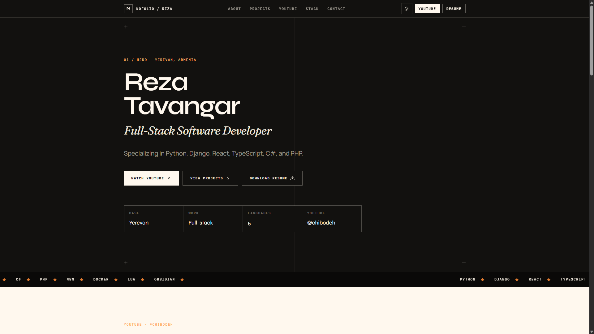
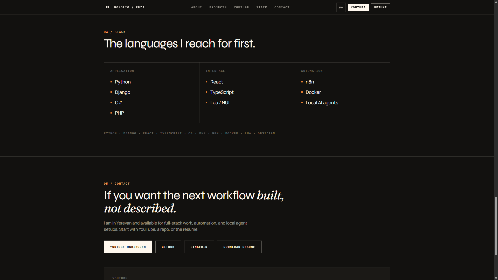
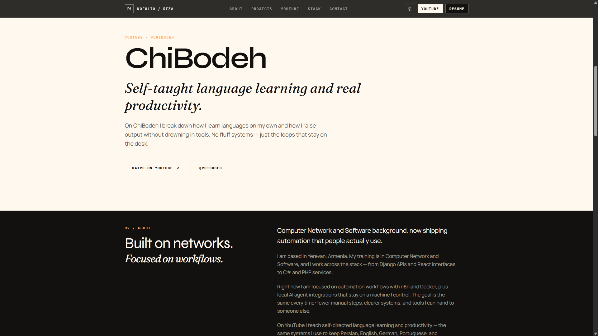
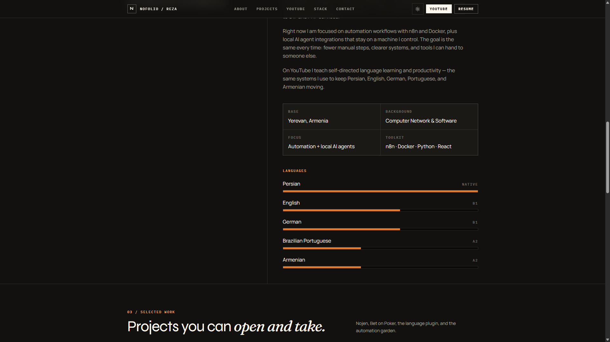

# Nofolio

Open-source personal portfolio for developers. Static Next.js, GitHub Pages, no backend.

**Live preview:** https://rezanoel.github.io/Nofolio/

**Repo:** https://github.com/RezaNoel/Nofolio

This is Reza Tavangar’s site (Yerevan). Fork it, change the copy, put your own resume in `public/resume.pdf`, and host it on GitHub Pages.



## What you get

- One static homepage — no CMS, no API, no database
- Light / dark theme (follows the OS, with a toggle)
- Hero with resume download
- YouTube block (ChiBodeh — self-taught language learning and productivity)
- About + spoken-language bars (Native / B1 / A2)
- Project cards with live demo, GitHub, or download links
- Stack and contact
- `output: "export"` so the whole site is a folder of HTML/CSS/JS



## Preview

| | |
| --- | --- |
| [](https://rezanoel.github.io/Nofolio/#youtube) | [](https://rezanoel.github.io/Nofolio/#about) |

- Site: https://rezanoel.github.io/Nofolio/
- YouTube: https://www.youtube.com/@chibodeh
- GitHub: https://github.com/RezaNoel

## Projects on the live site

| Project | Links |
| --- | --- |
| **Nojen** — Django agile workspace (sprints, kanban, RBAC, i18n) | [repo](https://github.com/RezaNoel/Nojen) |
| **Bet on Poker** — dealer console, 6 boxes, 20s clock | [live](https://rezanoel.github.io/bet-on-poker/) · [repo](https://github.com/RezaNoel/bet-on-poker) |
| **Nolingo** — Obsidian flashcards with spaced repetition | download on the site |
| **Digital Garden & Workflows** — n8n, Telegram, Python scrapers | [garden](https://rezanoel.ir) |

## Stack

Next.js 15 (App Router, static export) · React 19 · TypeScript · Tailwind CSS 4 · GitHub Pages

## Run locally

Node 20+.

```bash
npm install
npm run dev
```

http://localhost:3000

```bash
npm run build
npm start
```

Copy lives in `src/data/site.ts`. Resume lives in `public/resume.pdf`.

## GitHub Pages

This repo is a **project site**: `https://USERNAME.github.io/Nofolio`.

Build with:

```bash
set NEXT_PUBLIC_BASE_PATH=/Nofolio
set NEXT_PUBLIC_SITE_URL=https://USERNAME.github.io/Nofolio
npm run build
```

Publish the `out/` folder to the `gh-pages` branch. `public/.nojekyll` is already in the tree so GitHub does not hide `_next`.

For a user site (`https://USERNAME.github.io`) leave `NEXT_PUBLIC_BASE_PATH` empty.

A workflow recipe is in `docs/github-pages-deploy.yml` if you want Actions to do the deploy.

## License

MIT. Use it for your own portfolio.
